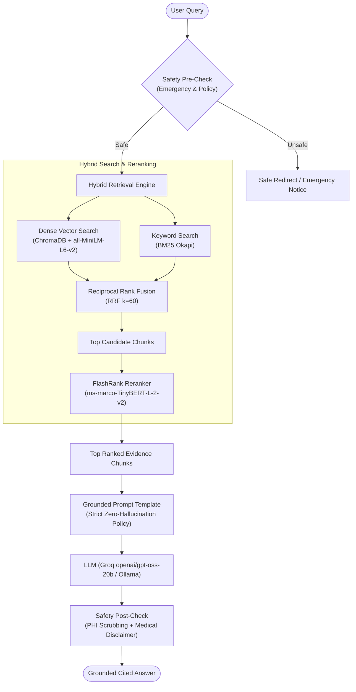

# Medical Q&A Assistant (LangChain RAG)

A production-grade, grounded medical question-answering assistant built with **LangChain**, **ChromaDB**, **BM25**, and **FlashRank** cross-encoder reranking. The system provides factual answers derived solely from official FDA drug labels and clinical practice guidelines, complete with inline source citations and safety policy guardrails.

---

## Architecture Overview



---

## Key Features

1. **100% Free & Fast**:
   - **LLM**: Groq free tier (`openai/gpt-oss-20b` or `llama-3.3-70b-versatile`) or local offline Ollama (`llama3.2`).
   - **Embeddings**: Local `sentence-transformers/all-MiniLM-L6-v2` (runs on CPU/GPU, $0 cost).
   - **Vector Store**: Local persistent ChromaDB.
   - **Reranker**: Local `FlashRank` CPU cross-encoder.
2. **Hybrid Retrieval with Reciprocal Rank Fusion (RRF)**:
   - Combines semantic vector similarity with exact medical keyword matching (BM25) to avoid drug name confusion.
3. **Cross-Encoder Reranking**:
   - Re-scores top candidate passages using cross-attention, boosting precision and top-1 hit accuracy.
4. **Strict Grounding & Source Citations**:
   - Strict prompt template forces the model to answer only using retrieved context excerpts.
   - If the context does not contain sufficient information, it returns `"Based on the provided medical references, this information was not found."`
   - Every claim is cited with numbered references (`[1]`, `[2]`) linked to source URLs, dates, and sections.
5. **Medical Safety Guardrails**:
   - Pre-check detects acute emergencies (chest pain, stroke, overdose, suicidal ideation) and personal diagnosis/dosing requests, safely redirecting users.
   - Post-check scrubs potential PHI and appends mandatory medical disclaimers.
6. **Full Observability with LangSmith**:
   - Built-in tracing for queries, latencies, retrieval scores, and LLM calls via LangSmith environment variables.
7. **Interactive Streamlit UI**:
   - Chat interface with session memory and expandable source citation inspector cards.

---

## Knowledge Base & Question Coverage Scope

The assistant provides grounded answers strictly from the indexed documents in [`data/raw/`](./data/raw/). It does **not** rely on pre-trained parametric memory for clinical facts, preventing hallucinations.

### 1. Indexed Medical Corpus (52 Chunks / 49 Sections)

| Drug / Topic | Category | Indexed Clinical Sections & Covered Questions |
| :--- | :--- | :--- |
| **Metformin** | Type 2 Diabetes | Indications, Severe renal impairment contraindications (eGFR < 30), Lactic acidosis boxed warning, Common GI adverse effects, Carbonic anhydrase & alcohol interactions, Hepatic glucose reduction mechanism. |
| **Lisinopril** | ACE Inhibitor (Hypertension) | Adult & pediatric hypertension, Heart failure adjunct, Fetal toxicity boxed warning (pregnancy discontinuation), Dry cough adverse reaction, Potassium supplement & NSAID interactions, RAAS inhibition mechanism. |
| **Amoxicillin** | Penicillin-Class Antibacterial | Bacterial ENT/skin infections, Severe beta-lactam hypersensitivity contraindications, *C. difficile* colitis warnings, Allopurinol rash & probenecid interactions, Cell wall lysis mechanism. |
| **Atorvastatin** | HMG-CoA Reductase Inhibitor | Hyperlipidemia & cardiovascular risk reduction, Active liver disease contraindications, Myopathy & rhabdomyolysis warnings, Strong CYP3A4 inhibitors (clarithromycin, gemfibrozil, grapefruit juice) interactions. |
| **Ibuprofen** | NSAID Analgesic/Antipyretic | Osteoarthritis, rheumatoid arthritis, mild-to-moderate pain, CABG surgery contraindication, Cardiovascular thrombotic & GI bleeding boxed warnings, Warfarin & ACE inhibitor interactions. |
| **Warfarin** | Vitamin K Antagonist (Anticoagulant) | Venous thromboembolism & AFib prophylaxis, Bleeding risk boxed warning & mandatory INR monitoring, CYP2C9 inhibitors (amiodarone, fluconazole) & Vitamin K interactions, VKORC1 enzyme inhibition mechanism. |
| **Omeprazole** | Proton Pump Inhibitor (GERD) | Duodenal/gastric ulcers, GERD, erosive esophagitis, Hypomagnesemia & bone fracture warnings, Clopidogrel CYP2C19 interaction, Gastric parietal cell H+/K+ ATPase inhibition mechanism. |
| **Albuterol** | Beta2-Agonist Bronchodilator | Bronchospasm relief, Paradoxical bronchospasm warnings, Cardiovascular tachycardia precautions, Beta-blocker antagonism interactions, Intracellular cyclic AMP (cAMP) bronchial smooth muscle relaxation. |
| **CDC / AAP Guidelines** | Clinical Practice Guideline | Diagnostic stewardship, Acute Otitis Media high-dose amoxicillin recommendation (80-90 mg/kg/day), Non-beta-lactam alternatives (azithromycin/clindamycin) for penicillin-allergic patients. |
| **AHA / ACC Guidelines** | Clinical Practice Guideline | Confirmed hypertension definition (BP >= 130/80 mmHg), ASCVD >= 10% risk thresholds, Stage 2 hypertension (>= 140/90 mmHg) dual-therapy mandate, First-line agents (ACEi, ARB, CCB, thiazide). |
| **ADA Guidelines** | Clinical Practice Guideline | Foundational first-line Metformin role, eGFR renal safeguards: annual monitoring, dose caution between 30-45 mL/min/1.73m², strict contraindication when eGFR < 30 mL/min/1.73m². |

### 2. Supported Question Types
* **Single-Drug Queries**: *"What are the contraindications for Metformin?"*, *"What enzyme does Atorvastatin inhibit?"*
* **Drug-Drug Interactions**: *"Can I take Ibuprofen if I am prescribed Warfarin?"*, *"Why should Omeprazole be avoided with Clopidogrel?"*
* **Black Box Warnings**: *"What is the boxed warning for Lisinopril regarding pregnancy?"*
* **Clinical Guideline Lookups**: *"What blood pressure threshold defines Stage 2 hypertension under AHA/ACC guidelines?"*

### 3. Out-of-Scope Queries & Fallback Behavior
* **Unindexed Drugs / Questions** (e.g. *"What is the dose of Ozempic?"*):
  The pipeline returns the zero-hallucination fallback:
  > *"Based on the provided medical references, this information was not found."*
* **Emergency & Personal Dosing Queries** (e.g. *"I have severe chest pain"*, *"Diagnose me"*, *"What dose should I give my child?"*):
  Intercepted by safety pre-checks before reaching the LLM and safely redirected.

### 4. How to Expand the Knowledge Base
To enable the assistant to answer questions on new drugs or guidelines:
1. Drop additional medical PDFs, JSON files, or text guidelines into [`data/raw/`](./data/raw/).
2. Run `python scripts/ingest.py`.
3. The new documents will be automatically chunked, embedded into ChromaDB, and indexed in BM25 with zero code changes.

---

Evaluated against the golden test suite (`data/eval/golden_set.json`) covering indications, contraindications, boxed warnings, drug-drug interactions, and clinical guidelines:

| Retrieval Pipeline | Recall@1 | Recall@3 | Recall@5 | MRR (%) | Avg Latency |
| :--- | :---: | :---: | :---: | :---: | :---: |
| **Dense Only (Chroma)** | 100.0% | 100.0% | 100.0% | 100.0% | 23.7 ms |
| **Hybrid (BM25 + Dense)** | 100.0% | 100.0% | 100.0% | 100.0% | 23.0 ms |
| **Hybrid + Rerank (FlashRank)** | 100.0% | 100.0% | 100.0% | 100.0% | 36.9 ms |

* **Emergency & Unsafe Query Refusal Accuracy**: **100.0%** (correctly redirected 4/4 unsafe/emergency cases).

---

## Quickstart Guide

### 1. Environment Setup
```bash
# Clone the repository
git clone <repo-url>
cd medical-RAG

# Activate virtual environment (Python 3.12 recommended)
.\.venv312\Scripts\Activate.ps1   # Windows PowerShell
# or: source .venv/bin/activate    # Linux / macOS

# Install dependencies
pip install -r requirements.txt
```

### 2. Configure Environment Variables
Copy `.env.example` to `.env`:
```bash
cp .env.example .env
```
Add your free Groq API key:
```env
LLM_PROVIDER=groq
GROQ_API_KEY=gsk_your_key_here
GROQ_MODEL=openai/gpt-oss-20b
```

*(Optional) Enable LangSmith tracing:*
```env
LANGCHAIN_TRACING_V2=true
LANGCHAIN_API_KEY=lsv2_pt_...
LANGCHAIN_PROJECT=medical-rag
```

### 3. Ingest Documents & Build Vector Store
```bash
python scripts/ingest.py
```

### 4. Run the Evaluation Benchmark
```bash
python src/eval/runner.py
```

### 5. Launch the Streamlit Chat UI
```bash
streamlit run src/ui/app.py
```

---

## Repository Structure

```
medical-RAG/
├── config/                  # Configuration defaults
├── data/
│   ├── eval/                # Golden benchmark test set & eval results
│   ├── raw/                 # Sample FDA drug labels (JSON) & guidelines (MD)
│   └── chroma/              # Persistent ChromaDB vector index
├── scripts/
│   └── ingest.py            # CLI script to chunk and index raw documents
├── src/
│   ├── config.py            # Centralized pydantic-settings & logger
│   ├── eval/
│   │   ├── metrics.py       # Recall@k, MRR, refusal metrics
│   │   └── runner.py        # Benchmark test runner
│   ├── generation/
│   │   ├── citations.py     # Source card & reference formatter
│   │   ├── generator.py     # End-to-end RAG pipeline
│   │   ├── llm.py           # LLM client provider (Groq / Ollama)
│   │   └── prompts.py       # Zero-hallucination prompt templates
│   ├── indexing/
│   │   ├── embeddings.py    # HuggingFace embeddings wrapper
│   │   └── vector_store.py  # Chroma vector store manager
│   ├── ingestion/
│   │   ├── chunking.py      # Structural metadata-preserving chunker
│   │   └── loaders.py       # PDF, JSON, and web/text loaders
│   ├── retrieval/
│   │   ├── bm25.py          # BM25 keyword index
│   │   ├── fusion.py        # Reciprocal Rank Fusion (RRF)
│   │   ├── hybrid.py        # HybridRetriever combining dense & sparse
│   │   └── reranker.py      # FlashRank cross-encoder reranker
│   ├── safety/
│   │   └── guardrails.py    # Policy checks, PHI scrubbing, emergency filters
│   └── ui/
│       └── app.py           # Interactive Streamlit chat application
├── .env.example             # Configuration template
├── .gitignore               # Git ignore rules
├── PRD.md                   # Product Requirements Document
├── requirements.txt         # Pinned project dependencies
└── README.md                # Documentation & architecture guide
```

---

## Medical Policy & Disclaimer
This software is intended strictly for educational and portfolio demonstration purposes. It does not provide medical diagnoses, treatment plans, or individual dosing instructions. Always seek the advice of a qualified physician or healthcare provider with any medical questions.
